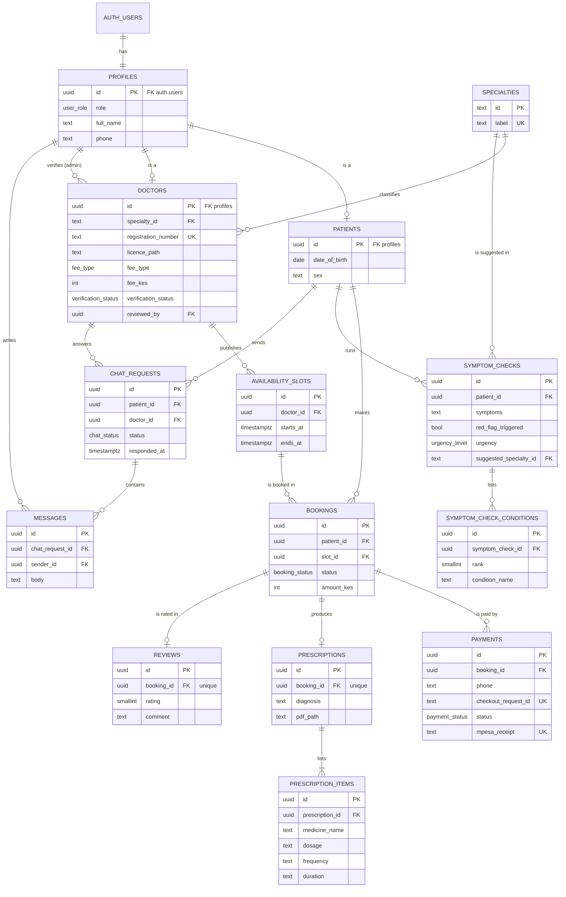

# AfyaLink database design

PostgreSQL (hosted on Supabase), normalised to **Third Normal Form (3NF)**.
The SQL lives in `supabase/migrations/`:

- `0001_tables.sql`: the 14 tables, keys, constraints and indexes
- `0002_security.sql`: row-level security, the signup trigger, database functions, storage and realtime
- `0009_patient_file.sql`: `patients.blood_group` (a fact about the patient), and `bookings.symptom_check_id`: the symptom check shared with that booking's doctor, set only by `hold_slot()` (the patient's latest check from the last 24 hours, unless they've paid for a booking since). It's a fact about the booking ("which check its doctor may read"), so it belongs on `bookings`, not on `symptom_checks`. A new policy lets only the doctor of a **paid** booking read that one check (and its conditions); the patient's other checks stay private, and admins still see none.
- `0008_prescription_completes_consultation.sql`: a consultation is over once the prescription is issued, or (without one) once its slot has ended. `booking_has_ended()` (used by the reviews policy) and the "consultations completed" count in `admin_analytics()` now use that rule. "Over" isn't stored; it's worked out from the slot's end time and whether a prescription exists.
- `0007_suspended_doctors.sql`: stops suspended doctors appearing in search or being booked (`is_suspended()`, `get_suspended_doctors()`, and new versions of `get_available_slots()` and `hold_slot()`). Suspension isn't stored in our tables; it's read from `auth.users.banned_until`, so there's only one copy.
- `0006_chat_read_tracking.sql`: `chat_requests.patient_last_read_at` and `doctor_last_read_at` (when each side last opened the chat), `mark_chat_read()` and `unread_chat_messages()`. "Unread" isn't stored; it's worked out from these times and the messages' `created_at`.
- `0005_prescription_downloaded_at.sql`: adds `prescriptions.downloaded_at`, when the patient first downloaded the PDF (a fact about the prescription itself). It's written only by the server's download route, after an access check.
- `0004_admin_analytics.sql`: `admin_analytics()`, which gives the admin dashboard **aggregated numbers only** (counts, sums, averages). Admins still can't read any individual symptom check or prescription.
- `0003_drop_video_room_url.sql`: removes `bookings.video_room_url`. The video room name is derived from the booking ID (`consult-<id>`), so storing it would duplicate data.

## Entity-relationship diagram



In the Supabase dashboard, **Database → Schema Visualizer** draws the same diagram from the live tables.

## The tables

| Table | One row is… | Key relationships |
|---|---|---|
| `specialties` | a medical specialty (lookup list) | used by doctors and symptom checks |
| `profiles` | a user of any role | 1-to-1 with Supabase's `auth.users` (email and password live there) |
| `patients` | patient-only details | 1-to-1 with profiles (subtype) |
| `doctors` | doctor-only details (licence, fee, verification) | 1-to-1 with profiles (subtype); many-to-1 with specialties |
| `availability_slots` | one time slot a doctor offers | many-to-1 with doctors |
| `bookings` | a patient booking one slot | many-to-1 with patients and slots |
| `payments` | one M-Pesa STK Push attempt | many-to-1 with bookings (a patient can retry) |
| `symptom_checks` | one use of the symptom checker | many-to-1 with patients |
| `symptom_check_conditions` | one possible condition from a check | many-to-1 with symptom checks |
| `prescriptions` | the prescription from one consultation | 1-to-1 with bookings |
| `prescription_items` | one medicine on a prescription | many-to-1 with prescriptions |
| `reviews` | a patient's rating of one consultation | 1-to-1 with bookings |
| `chat_requests` | one follow-up chat request (and its 3-hour window) | many-to-1 with patients and doctors |
| `messages` | one chat message | many-to-1 with chat requests |

## Why it is in 3NF

**1NF: every cell holds one value, and every row has a primary key.**
- Every table has a primary key (`id`).
- Lists get their own table instead of a comma-separated column: a doctor's slots (`availability_slots`), the possible conditions from a symptom check (`symptom_check_conditions`), and the medicines on a prescription (`prescription_items`).

**2NF: every non-key column depends on the whole key.**
- Every table has a single-column primary key, so no column can depend on only *part* of a key. 2NF holds automatically once 1NF holds.

**3NF: no non-key column depends on another non-key column.**
- **Supertype / subtype split.** Things every user has (name, phone, role) are in `profiles`. Doctor-only facts (licence, fee, specialty) are in `doctors`, and patient-only facts are in `patients`. This avoids a wide table full of empty columns that only apply to one role.
- **Specialty names are stored once.** `doctors.specialty_id` points to `specialties`. The label "Dermatologist" isn't repeated on every doctor.
- **`bookings` has no `doctor_id`.** The slot already belongs to a doctor (`slot_id → doctor_id`). Storing `doctor_id` on the booking as well would be a transitive dependency, and the two could disagree. We find the doctor by joining through the slot.
- **Patient and doctor names aren't copied** into bookings, prescriptions, reviews or chats. They're joined from `profiles` when needed.
- **Email isn't copied** into `profiles`. Supabase Auth already stores it in `auth.users`.
- **Derived values aren't stored. They're calculated when needed:**
  - a doctor's average rating, worked out from `reviews` (`get_doctor_ratings()`)
  - whether a slot is free, worked out from its bookings (`slot_is_taken()`)
  - when a payment hold expires: `bookings.created_at` + 5 minutes
  - when a follow-up chat closes: `chat_requests.responded_at` + 3 hours
  - whether a consultation is finished: the slot's `ends_at` has passed
  - the video room's name: `consult-<booking id>`

### Values that look duplicated but aren't
- **`bookings.amount_kes` vs `doctors.fee_kes`.** The fee is the doctor's *current* price, which they can change at any time. The booking amount is what this patient was charged on that day. It's a historical fact about the booking, so it depends only on the booking's key.
- **`payments.phone` vs `profiles.phone`.** A patient may pay from a different M-Pesa number (e.g. a parent's). The payment row records the number that actually paid.

## Integrity rules enforced by the database
- **Foreign keys** on every relationship (e.g. a booking can't point to a slot that doesn't exist).
- **CHECK constraints:** M-Pesa phone format `2547XXXXXXXX` / `2541XXXXXXXX`, fee between KES 100 and 50,000, rating 1–5, a slot must end after it starts and be 15 minutes to 3 hours long.
- **No overlapping slots** for the same doctor (an exclusion constraint).
- **No double booking:** at most one active booking (`pending_payment` or `confirmed`) per slot (a partial unique index). `hold_slot()` also locks the slot row, so two patients clicking at the same moment can't both hold it.
- **One waiting chat request** per patient–doctor pair.

## Security (row-level security)
RLS is enabled on **all 14 tables**. With RLS on, a row is hidden unless a policy allows it. In summary:
- Patients see only their own bookings, payments, symptom checks, prescriptions and chats.
- Doctors see only bookings for their own slots, and the profiles of their own patients.
- Unverified doctors and their slots are hidden from patients. Suspended doctors are left out of search and can't be booked (`hold_slot()` refuses them).
- Bookings and payments can't be written from the browser at all. Bookings go through `hold_slot()`, which works out the price itself, and payments are written by the server when the M-Pesa callback arrives.
- Symptom checks and prescriptions aren't visible even to admins (data minimisation under the Kenya Data Protection Act, 2019).
- Nobody can make themselves an admin: signup only creates patients or doctors.

## Creating an admin account
1. Supabase dashboard → **Authentication → Users → Add user** (email + password, tick "Auto confirm").
2. **SQL Editor**, replacing the email:
   ```sql
   update public.profiles set role = 'admin', full_name = 'AfyaLink Admin'
   where id = (select id from auth.users where email = 'admin@example.com');
   delete from public.patients
   where id = (select id from auth.users where email = 'admin@example.com');
   ```
